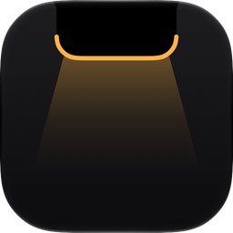
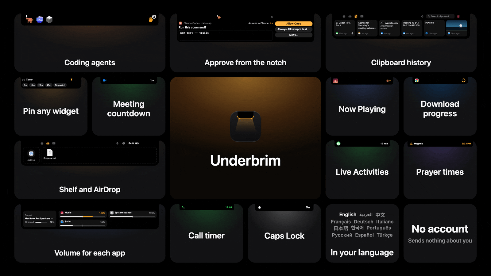
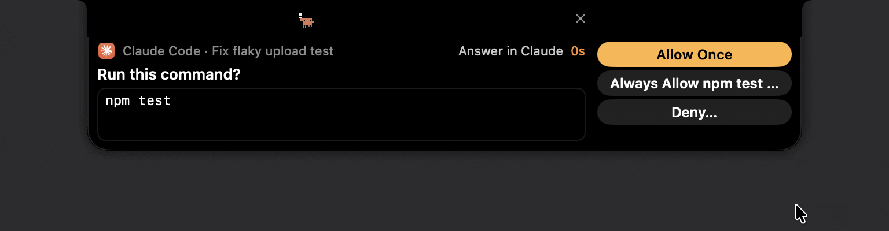

<p align="center">
  
</p>

<h1 align="center">Underbrim</h1>

<p align="center">A free, open-source notch app for the Mac.</p>

<p align="center">
  <a href="https://github.com/ibrahim-alohali/underbrim/releases/latest"></a>
  <a href="#requirements"></a>
  
  <a href="LICENSE"></a>
</p>

<p align="center">
  <a href="#what-it-does">What it does</a> ·
  <a href="#install">Install</a> ·
  <a href="#privacy">Privacy</a> ·
  <a href="#build-from-source">Build from source</a> ·
  <a href="#contributing">Contributing</a>
</p>

<p align="center">
  
</p>

Underbrim puts music, your calendar, the apps you use, clipboard history, a
shelf for files, downloads, meetings and your Claude Code, Codex and other
coding agent sessions into one shape that grows out of the notch. Made by
[Ibrahim Alohali](https://github.com/ibrahim-alohali).

I wanted a notch app as polished as the paid ones, but free and open. There's
no account and no licence server, and all of the source is here.

## What it does

### The notch and Settings

- Opens out of the camera housing as one shape and stays low. Closed, it
  matches the cutout exactly, and every tab is a single row.
- Settings has a search. Type what you're after and the page opens with that
  setting highlighted.
- Works with the keyboard, VoiceOver and Reduce Motion.
- Comes in English, Arabic, Chinese (Simplified), French, German, Italian,
  Japanese, Korean, Portuguese (Brazil), Russian, Spanish and Turkish. It
  follows your Mac's language, or you can pick one in Settings > General.
  Arabic is laid out right to left, with the playback controls left to right
  as in Apple's own apps.

### Home and widgets

Home shows the widgets you pick, in the order and size you want: Now Playing,
a small calendar with today's next events (click one to open or join it), the
mirror, a scratchpad that ⌃⇧⌘N jumps into from any app once it's on Home,
Quick Launch with your apps next to the ones you use most, and smaller ones
for prayer times, a timer, reminders, shortcuts, unread counts, calls and
system load. Press and hold any widget to pin it, and the notch keeps just
that one, slim, beside the camera. Quick Launch can also be pinned as a row
under the notch.

### Coding agents

Underbrim follows your Claude Code and Codex sessions, and Qwen Code, Qoder,
Cursor and Antigravity if you turn them on: which one is working, which one is
waiting for you, and how much of your plan you've used, with a count of tokens
per day. Each agent has a small animated creature and a short sound for when it
needs you. Hover to see the details, click to jump into the session, or answer
an approval, a question or a plan right in the notch. Nothing is approved
without your click.

<p align="center">
  
</p>

### Music, files and everything else

- Shows what's playing in Apple Music, Spotify and other players, in the
  album's colours, and can replace macOS's volume and brightness display with
  its own. The Sound page gives each app that's playing its own volume, up to
  twice its normal level.
- Clipboard history keeps what you copy, with the app and time of each item.
  You can search it, pin or delete items, copy one back with a click or
  Return, and clear everything you haven't pinned. It's stored encrypted on
  your Mac and leaves out copies from password managers and one-time codes.
- Drag a file toward the notch and it opens and stays open until you let go.
  Drop the file on the Shelf to keep it close, or on AirDrop to send it, and
  drag it back out whenever you need it.
- Download progress from Chrome and Safari shows on the notch's sides, and so
  does a countdown with a Join button before your next meeting.
- Like the iPhone's Dynamic Island, it shows Live Activities from your iPhone
  (a delivery, a ride, a game, a flight), deliveries from apps that only send
  notifications, how long you've been on a call with a Leave button where the
  app allows it, a padlock when you unlock, and Caps Lock turning on and off.
- Works out today's prayer times on your Mac and shows each one on the notch
  when its time comes.

## Install

Download the latest `.dmg` from
[Releases](https://github.com/ibrahim-alohali/underbrim/releases/latest), open
it and drag Underbrim to Applications. The coding agent hooks, Claude Code's
status line and the Chrome extension only work with a copy in Applications (or
`~/Applications`).

> [!IMPORTANT]
> The first time you open Underbrim, macOS says Apple could not verify it is
> free of malware. It says that because Underbrim isn't notarized by Apple,
> which needs a paid developer account. Click **Done**, not Move to Trash. Then
> open **System Settings > Privacy & Security**, scroll down and click **Open
> Anyway** next to Underbrim. Confirm with your password or Touch ID, then click
> **Open Anyway** again. The button stays there for about an hour after you try
> to open the app, and you only need to do this once. If you'd rather use
> Terminal: `xattr -dr com.apple.quarantine /Applications/Underbrim.app`

Underbrim doesn't update itself. Every release is signed with the same
certificate, so if you install a newer one from GitHub, the permissions you
gave Underbrim (Calendar, Camera, Bluetooth and so on) carry over.

Clipboard history is encrypted with a key that this Mac's Secure Enclave
seals, so a new version opens it without asking. A Mac without a Secure Enclave
(an Intel Mac without the T2 chip, or a virtual machine) keeps the key in your
Keychain instead, and macOS may ask once after each update whether Underbrim
can use it. Choose **Always Allow**. It asks because the certificate is
self-made rather than an Apple Developer ID.

If you update from a version that kept the key in the Keychain, the history
from before stays sealed with that key. Settings > Clipboard can bring it back
(macOS asks for the key once) or delete it.

### Requirements

Underbrim needs macOS 14 Sonoma or later. iPhone Live Activities need macOS 26
or later and iPhone Mirroring. I've only tested it on macOS 27 so far. If
you're on an older version, please tell me how it goes in
[Issues](https://github.com/ibrahim-alohali/underbrim/issues). It's made for
Macs with a notch, and draws its own on Macs without one.

## Privacy

Underbrim has no account and doesn't send anything about you anywhere. The
only requests it makes on its own are album artwork from the address your
music app gives it, and the town search for prayer times, which sends what you
type to Apple Maps.

Several features need Accessibility, which macOS 27 calls "Device Control and
Data Access". Underbrim asks for it only when you turn one of them on.

Most features that read things on your Mac are off until you turn them on.
[PRIVACY.md](docs/PRIVACY.md) goes through each one: what it reads, what it keeps
and where, and whether it's on from the start.

## Tips

- Holding a file at the very top edge of the screen opens Mission Control,
  and Underbrim can't stop that. Let go a little lower, on the drop area below
  the edge, or turn off **System Settings > Desktop & Dock > Drag windows to
  top of screen to enter Mission Control**.
- Settings > Widgets sets up Home and the order of the tabs.
- Video and music in a Safari private window don't show on the notch:
  macOS doesn't share them with other apps. A normal window works.

## Uninstall

First undo anything Underbrim set up in other apps:

- In Settings > Coding Agents, turn off "Answer Claude Code in the notch",
  "Answer Codex in the notch", each agent under More agents, and "Claude plan
  usage from terminal sessions".
- In Settings > Downloads, remove the Chrome connection, then remove the
  Underbrim Downloads extension at `chrome://extensions`.
- In Settings > Volume & Brightness, set Lunar or BetterDisplay back to
  Built-in so that app shows its own display again.

Then quit Underbrim (right-click the notch > Quit Underbrim) and move it to
the Trash. To remove everything it keeps as well, delete the folder
`~/Library/Application Support/Underbrim`, its settings
(`defaults delete io.github.ibrahim-alohali.underbrim`), its caches
(`~/Library/Caches/io.github.ibrahim-alohali.underbrim` and
`~/Library/HTTPStorages/io.github.ibrahim-alohali.underbrim`), the Keychain
item "Underbrim clipboard history key" if there is one, and its entries in
System Settings > Privacy & Security.

## Build from source

You need Xcode 26 or later. The app runs on macOS 14 or later.

```sh
git clone https://github.com/ibrahim-alohali/underbrim.git
cd underbrim
xcodebuild -project Underbrim.xcodeproj -scheme Underbrim -configuration Release build
```

To sign with your own identity, open the project in Xcode and pick your team
under Signing & Capabilities. `xcodebuild test` on the same scheme runs the
tests.

A build from source has the same bundle id as the release, so it shares an
installed Underbrim's settings, folder and permissions, and the tests run
inside it. Quit the installed copy first, or set `UNDERBRIM_BUNDLE_ID` in the
project to an id of your own to get a separate copy.

Releases are built with `scripts/release.sh`. A one-time
`scripts/make-signing-keychain.sh` creates the signing certificate on the Mac
that makes releases; it isn't in the repository.

## Contributing

Bug reports, ideas and pull requests are welcome.
[CONTRIBUTING.md](.github/CONTRIBUTING.md) says what an issue needs and how to send a
change. Please report security problems privately, as
[SECURITY.md](.github/SECURITY.md) describes.

## Acknowledgments

Underbrim includes code from
[Boring Notch](https://github.com/TheBoredTeam/boring.notch) by TheBoredTeam
and its contributors, and from [Atoll](https://github.com/Ebullioscopic/Atoll).
It also uses MediaRemoteAdapter, adhan-swift, Defaults, KeyboardShortcuts,
DynamicNotchKit, NotchDrop and the other projects listed, with their licenses,
in [THIRD_PARTY_LICENSES](docs/THIRD_PARTY_LICENSES). Thank you to everyone who
made them.

## License

Underbrim is free software under the [GNU General Public License v3](LICENSE),
© 2026 Ibrahim Alohali and contributors. It includes code from other
open-source projects, and their copyright and license notices are in
[NOTICE](NOTICE) and [THIRD_PARTY_LICENSES](docs/THIRD_PARTY_LICENSES).

The license doesn't cover the name Underbrim or its icon. If you share a
changed version, give it a name and icon of its own (the terms are in
[NOTICE](NOTICE)).

Other product names and marks mentioned here belong to their owners.
Underbrim isn't affiliated with or endorsed by any of them.
